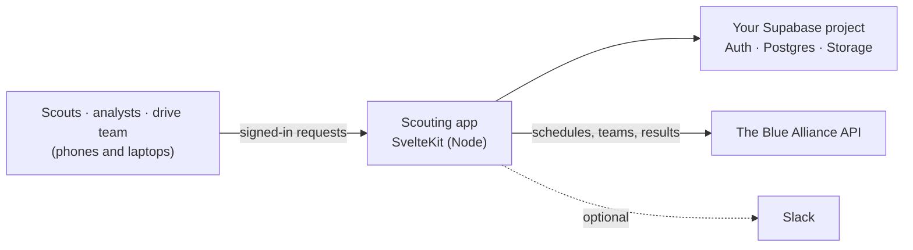

# FRC Scouting App

A scouting and match-analysis web app for an FRC team at competition. Scouts record what robots do in matches and in
the pits from their phones (offline too), and that data becomes team rankings, a strategy board, match previews and a
shared picklist for alliance selection. It is a SvelteKit app on a Supabase database, and it is yours to customize:
the team, name, colors, logo, menu and scouting forms are all set on the site itself.



## What it does

- **Scout:** match scouting (data, performance and robot reports), pit scouting with photos, quick scout and notes,
  each scout's assignments and their submitted reports. Reports made with no signal are queued and sent later.
- **Analyze:** Team View with charts, a Strategy Board, Match View, power and match rankings, EPA, and an optional AI
  assistant that answers questions from your scouting data.
- **On the field:** your team's schedule for the drive team, a shared picklist and Blue Alliance lookups.
- **Scouting Admin:** event setup, assignments, editable scouting forms,
  people and competition roles, exports (Excel, CSV, Google Sheets) and Team settings.

The match scouting form and field map follow the **2026 FRC game**. Custom questions can be added from the site
(Scouting Admin > Edit); changing the built-in game fields for a new season is a code change (see
[Customizing](#customizing)).

## Quick start

You need **Node.js 22 or newer**, a free **[Supabase](https://supabase.com)** project and a free
**[The Blue Alliance](https://www.thebluealliance.com/account) read API key**.

### 1. Get the code

```sh
git clone https://github.com/yuvanshankar30/frc-scoutingapp.git
cd frc-scoutingapp
npm install
```

### 2. Create the database

Create a project at [supabase.com](https://supabase.com), then apply the schema in `supabase/migrations/`. Either:

- **Supabase CLI** (recommended): `npx supabase login`, `npx supabase link --project-ref <your-project-ref>`, then
  `npx supabase db push`.
- **SQL editor:** open the project's SQL editor, paste the contents of
  `supabase/migrations/20260101000000_initial_schema.sql`, and run it once.

The schema holds no team data. It creates the tables with row-level security, a trigger that gives every new account a
profile waiting for approval, and the storage buckets for pit photos and your logo.

Then in the Supabase dashboard, under **Authentication > URL Configuration**, set the **Site URL** to the address the
app will run at (`http://localhost:5173` for now) and add it to the **Redirect URLs**. Sign-up confirmation emails link
back to it.

### 3. Configure the server

```sh
cp .env.example .env
```

Fill in `.env` ([every variable is explained below](#environment-variables)). The required ones:

| Variable | Where to find it |
| --- | --- |
| `PUBLIC_SUPABASE_URL`, `PUBLIC_SUPABASE_ANON_KEY` | Supabase dashboard > Project Settings > API |
| `SUPABASE_SERVICE_KEY` | Same page, the `service_role` key. Server only; never share or commit it |
| `APP_ORIGIN` | The address you open, e.g. `http://localhost:5173` |
| `TBA_API_KEY` | The Blue Alliance > Account > Read API Keys |

### 4. Make your admin account and set your team

The site has no setup screen. Make the first admin account from the command line, using the service key in `.env`:

```sh
npm run admin -- create-admin --email you@example.com --password 'a-long-password' --name "Your Name"
```

Then set your team, either the same way:

```sh
npm run admin -- set-team --number 1234 --name "Robo Raptors" --color "#2563eb" --timezone America/Chicago
```

or on the site after signing in, in **Scouting Admin > Team settings** (team number and name, other teams your members
compete for, app name, brand color, logo, default theme, timezone, which pages are in the menu, and whether people may
create their own accounts). Until a team is set, admins see a reminder at the top of every page.

`npm run admin -- help` lists every option; `npm run admin -- show` prints the current settings.

### 5. Run it

```sh
npm run dev
```

Open http://localhost:5173 and sign in with the admin account.

### 6. Bring your team in

- **People sign up** on the sign-in page ("Create an account"). New accounts can see nothing until an admin approves
  them in **Scouting Admin > People**. You can turn self sign-up off in Team settings.
- **Or add accounts yourself** in **Scouting Admin > Add user**, for example shared logins for scouting tablets. A bare
  username like `pit1` becomes `pit1@scouting.local` (no email is sent). Accounts made here are approved at once.
- Give people **competition roles** (Scouting Lead, Drive Team, Pit Crew, scout roles and so on) in Scouting Admin >
  People. The Competition Lead and the lead roles get Scouting Admin.

Then pick your event in **Scouting Admin > Event setup** and start scouting.

## Customizing

**From the site (no code):**

| What | Where |
| --- | --- |
| Team number and name, other teams | Scouting Admin > Team settings |
| App name, brand color, logo, default theme | Scouting Admin > Team settings |
| Timezone used for match times and exports | Scouting Admin > Team settings |
| Which optional pages appear in the menu (Drive Team, AI analytics, ...) | Scouting Admin > Team settings |
| Whether people may create their own accounts | Scouting Admin > Team settings |
| Custom questions on the match and pit scouting forms | Scouting Admin > Edit |
| Who scouts what | Scouting Admin > Assignments |

**In the code:**

| What | Where |
| --- | --- |
| Colors, spacing and fonts (design tokens) | `src/app.css`, `src/calm.css` (dark and light themes) |
| Menu groups and pages | `src/lib/app/navigation.js` |
| Competition roles | `src/lib/scouting/competitionRoles.js` |
| Built-in match scouting fields for the season's game | `src/lib/scouting/matchScouting.js`, `src/lib/scouting/forms/`, `src/routes/matchscout/` |
| Field map image | `static/rebuilt-2026-field.png`, `src/lib/components/scouting/RebuiltFieldMap.svelte` |
| Pit scouting questions | `src/lib/scouting/pitForm.js` |
| Database schema | a new file in `supabase/migrations/` (never edit one that has been applied) |

## Deploying

The app is a standard Node server (`@sveltejs/adapter-node`), so it runs anywhere Node 22 runs: a VPS, Render, Fly.io,
Railway, Google Cloud Run, a laptop in the pits.

**With Docker** (the Supabase URL and anon key are built into the browser bundle, so they are build arguments):

```sh
docker build \
  --build-arg PUBLIC_SUPABASE_URL=https://your-project-ref.supabase.co \
  --build-arg PUBLIC_SUPABASE_ANON_KEY=your-anon-key \
  -t frc-scoutingapp .
docker run -p 8080:8080 --env-file .env -e ORIGIN=https://scouting.example.org frc-scoutingapp
```

**Without Docker:**

```sh
npm run build          # needs PUBLIC_SUPABASE_URL and PUBLIC_SUPABASE_ANON_KEY set
ORIGIN=https://scouting.example.org node build
```

When you deploy:

- Set every variable from `.env` in your host's environment (or secret manager), with `APP_ORIGIN` set to the public
  address. Also set `ORIGIN` to the same address: SvelteKit's adapter uses it to check where requests come from.
- Add the public address to Supabase's **Site URL** and **Redirect URLs**.
- Serve it over HTTPS.
- Behind a proxy or load balancer (Cloud Run, Render, Fly.io, nginx, ...), set `ADDRESS_HEADER=X-Forwarded-For` and
  `XFF_DEPTH=1` so the app sees each visitor's address. The per-address limit on the
  `/api/tba/*` proxies relies on it; without it every visitor looks like the proxy.
- Optional daily data cleanup check: have a scheduler (cron, Cloud Scheduler, GitHub Actions schedule, ...) send
  `POST /api/scouting-admin/retention-cron` with the header `Authorization: Bearer <CRON_SECRET>`. It only tells admins
  when old data could be deleted to stay under the Supabase free-plan limits; an admin approves every cleanup.

More in [docs/architecture/deployment.md](docs/architecture/deployment.md).

## Environment variables

Also listed, with comments, in [.env.example](.env.example).

| Variable | Required | What it is for |
| --- | --- | --- |
| `PUBLIC_SUPABASE_URL` | Yes | Your Supabase project URL |
| `PUBLIC_SUPABASE_ANON_KEY` | Yes | The project's anon (public) key |
| `SUPABASE_SERVICE_KEY` | Yes | The service_role key, used only by the server |
| `SUPABASE_URL` | No | A different Supabase address for the server, if it needs one |
| `APP_ORIGIN` | Yes | The public address of the site |
| `TBA_API_KEY` | Yes | The Blue Alliance read key |
| `PUBLIC_USERNAME_EMAIL_DOMAIN` | No | Domain for bare-username logins (default `scouting.local`) |
| `SLACK_BOT_TOKEN` | No | Slack DMs for assignments and match reminders |
| `SLACK_PIT_PROBLEMS_CHANNEL` | No | Slack channel id for pit problem alerts |
| `GEMINI_API_KEY` or `OPENAI_API_KEY` | No | The AI analytics page (`ASSISTANT_PROVIDER`, `ASSISTANT_MODEL`, `ASSISTANT_BASE_URL` override it) |
| `GOOGLE_DRIVE_SERVICE_ACCOUNT_KEY` | No | Google Sheets export |
| `CRON_SECRET` | No | Token for the daily data cleanup check |
| `RETENTION_DB_LIMIT_MB`, `RETENTION_STORAGE_LIMIT_MB` | No | Size limits for that check (defaults 400 and 800) |

## Development

```sh
npm run dev            # dev server on http://localhost:5173
npm test               # unit tests (also fails if src/ is not formatted)
npm run check          # svelte-check, fails on warnings
npm run lint           # ESLint
npm run format         # Prettier; run it after every change
```

The database's row-level security has its own test, `supabase/tests/rls_access.sql`, which runs against a local
Supabase (`npx supabase start`). See [docs/development/](docs/development/README.md).

## Project layout

| Path | What's there |
| --- | --- |
| `src/routes/` | Pages and API routes (`src/routes/api/`) |
| `src/lib/` | Shared code: `app/` (settings, auth helpers, navigation), `scouting/`, `matches/`, `components/`, `server/` (server-only) |
| `supabase/migrations/` | The database schema |
| `supabase/tests/` | Row-level security test |
| `static/` | Icons and the field image |
| `docs/` | How every screen and the system work |

## Documentation

| Topic | Where |
| --- | --- |
| Every screen, by menu group, plus architecture, deployment and development | [docs/](docs/README.md) |
| Team settings and the admin command | [docs/scouting-admin/team-settings.md](docs/scouting-admin/team-settings.md) |
| How access and data are protected | [docs/security/](docs/security/README.md) |
| Code conventions | [docs/development/conventions.md](docs/development/conventions.md) |
| Versions | [VERSION.md](VERSION.md) |
