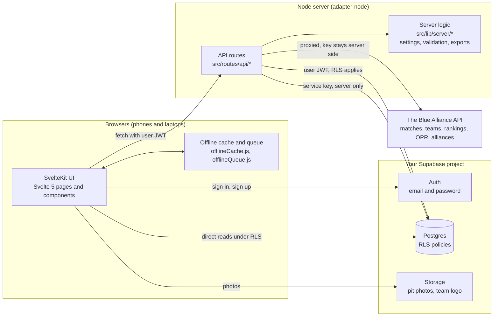
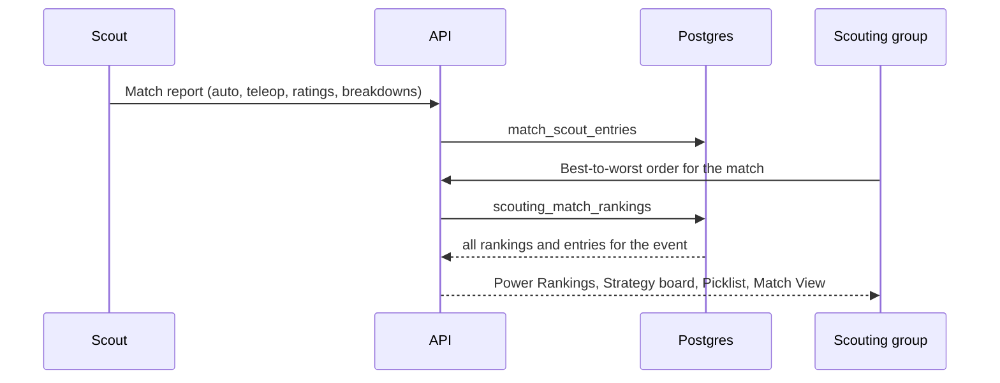

# Architecture

How the app fits together: the pieces, how a request flows, how the team's settings, accounts and access work, and how
a match report becomes a ranking. For what the app *does* feature by feature, see the page folders in
[docs/](../README.md).

## The system

## Request path

The browser signs in with Supabase Auth and sends the user's JWT with every API call. Most routes build a Supabase
client from that JWT, so Postgres row-level security decides what the caller can see. A few routes use the service key
for writes scouts are not granted directly (match entries, pit problems, deadlines, team settings) and check the
caller themselves first. The Blue Alliance is only called from the server so its API key never reaches the browser.

## Team settings

Everything team-specific lives in one row of `app_settings`: team number and name, other teams members compete for, app
name, brand color, logo, default theme, timezone, hidden pages and whether self sign-up is allowed.

- `src/lib/app/teamSettings.js` checks and normalizes them (browser and server share it) and turns the brand color
  into the theme's `--accent*` CSS variables.
- `src/lib/server/teamSettings.js` reads them on the server with a 30-second cache. The root layout's server load
  (`src/routes/+layout.server.js`) hands them to every page, and the `team` store (`src/lib/stores/team.js`) gives pages
  `$ourTeamKey` and `$ourTeamNumber`.
- The row exists from the start with no team. Until a team is set, pages fall back to generic names and admins see a
  reminder linking to Team settings.
- `POST /api/team-settings` (admins and the Competition Lead) changes them, including uploading the logo to the public
  `branding` bucket. `npm run admin -- set-team` (`scripts/admin.mjs`) changes them from the command line with the
  service key, through the same checks.

Details: [Team settings](../scouting-admin/team-settings.md).

## Shared code

API routes don't build their own clients or checks. Use these instead of copying them:

| Need | Module |
| --- | --- |
| A Supabase client as the caller (RLS), the service client, the signed-in user, `querySingle`, `isMissingTable` | `src/lib/server/supabaseClients.js` |
| The service-role client itself | `src/lib/server/serviceClient.js` |
| The team's settings on the server | `src/lib/server/teamSettings.js` |
| Who the caller is: profile, roster keys, approval (`isApprovedProfile`, `canSeeScoutingRoutes`), Scouting Admin, the scouting form gate `requireScoutingActor`, `resolveEventKey` | `src/lib/server/scouting/scoutingAccess.js` |
| Who can publish or be given match, pre-scout and pit assignments | `src/lib/server/scouting/assignmentAccess.js` |
| Cron bearer tokens | `src/lib/server/bearerAuth.js` |
| Every call to The Blue Alliance (`tbaFetch`, `tbaJson`, `tbaGet`) and the `/api/tba/*` proxy handler (`tbaProxy`) | `src/lib/server/integrations/tba.js` |
| Slack (optional) | `src/lib/server/integrations/slack.js`, `slack_notifications.js`, `pit_problem_notifications.js` |
| Scouting Admin's API: dashboard models, coverage, roles, event data, data reset, and the POST action table | `src/lib/server/scouting/admin/` |
| Match order and labels (`compareMatchKeys`, `compareTbaMatches`, `matchLabel`, `tbaMatchLabel`, `shortMatchLabel`) | `src/lib/matches/matchKeys.js` |
| Dates and times in the team's timezone | `src/lib/app/timezone.js` |
| `round`, `mean` (missing values stay `null`) | `src/lib/stats.js` |
| Pit Scout's choices, limits and read-back rules | `src/lib/scouting/pitForm.js` |
| `authFetch` (fetch with the user's token) in the browser | `src/lib/app/supabase.js` |

`npm run lint` (ESLint) catches undefined names and dead code; `npm run check` fails on any svelte-check warning.

## Accounts

People sign in at `/login` with an email (or a bare username, see [sign-in](../app/sign-in.md)) and password, checked
by Supabase Auth. A trigger on `auth.users` (`handle_new_user`) gives every new account a `user_profiles` row that is
**pending**: no role, no permissions. Accounts come from self sign-up (when Team settings allow it) or from
`npm run admin -- create-admin` (an admin, made with the service key).

## Access model

Nothing is visible until an account is approved (`user_profiles.role = 'admin'` or the `CAN_SEE_ROUTES` permission,
not banned). The database function `approved_user()` is what the row-level security policies check, so this holds even
for someone calling Supabase directly with the public anon key. Scouting Admin pages and the write side of deadlines
and assignments additionally require an admin, the Competition Lead, or a lead competition role. A trigger on
`user_profiles` stops anyone from raising their own role, permissions or team. More in
[security](../security/README.md).

## Offline

Event venues have bad Wi-Fi. Schedule, roster and OPR responses are cached in the browser, and scouting submissions
made offline are queued and sent when the connection returns (`offlineCache.js`, `offlineQueue.js`). Moving between
pages does not need the server once the app has loaded.

## Data flow: a match becomes a ranking

A scout submits a match report; the API writes it to `match_scout_entries`. The scouting group's best-to-worst order
for the match is written to `scouting_match_rankings`. Everything downstream (Power Rankings, the Strategy board, the
Picklist, Match View) reads back the event's rankings and entries and is computed from them.
